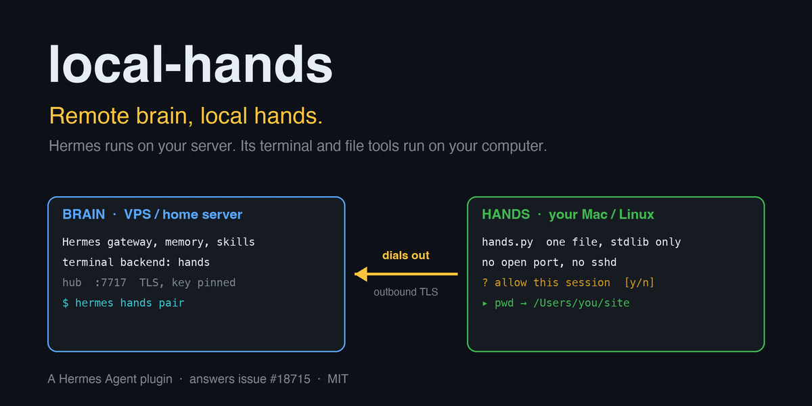
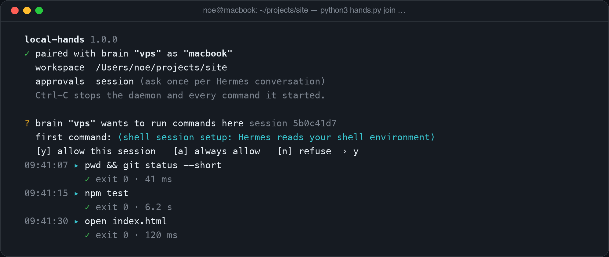
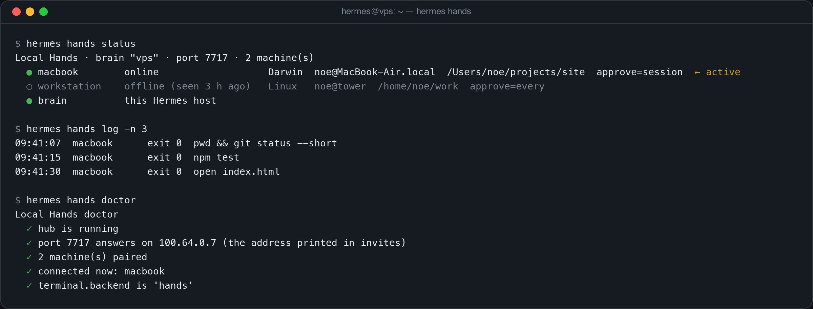

# local-hands

**Remote brain, local hands.** Hermes runs on your VPS or home server. Its `terminal`, `read_file`,
`write_file`, `patch`, `search_files` and `execute_code` tools run on *your own computer*, and your
computer asks you first.



```
you (Telegram, CLI…) ──►  Hermes on the server  ──►  "run pwd"  ──►  /Users/you/projects/site
                          memory, skills, sessions                    runs on your laptop
```

## Why

Hermes is at its best on a machine that never sleeps: gateway, cron, memory, sessions. Your code, your
files and your browser live on your laptop. Today you pick one: run Hermes on the laptop and lose the
always-on agent, or run it on the server and let it work on files it cannot see.

This is the most requested open feature of the repository:
[#18715 "Support remote Hermes agent with local tool execution"](https://github.com/NousResearch/hermes-agent/issues/18715),
with [#1855 "Multi-backend terminal: local + N named remotes"](https://github.com/NousResearch/hermes-agent/issues/1855)
next to it. `local-hands` implements both as a plugin, on the public terminal-backend surface, with no
change to Hermes.

It is a terminal backend plus a daemon, so a prompt or a skill cannot do it: commands have to leave the
server, cross the network, run under your account and come back with their output and exit status.

## Quickstart

On the Hermes host:

```bash
hermes plugins install noegng/local-hands
hermes plugins enable local-hands
hermes hands pair
```

`hermes hands pair` prints two lines. Run them on your computer, in the folder Hermes should work in:

```bash
curl -fsSk --pinnedpubkey 'sha256//…' https://your-server:7717/hands.py -o hands.py
python3 hands.py join 'hands://your-server:7717/…'
```

Back on the Hermes host:

```bash
hermes config set terminal.backend hands     # then restart the gateway if it is running
```

Ask Hermes to `run pwd`. The answer is a path on your computer, and the daemon's terminal shows the
command. Next time, `python3 hands.py up` reconnects.

The daemon needs Python 3.8+ and `bash`. It is one file and uses only the standard library. Your computer
opens no port and needs no SSH server: the daemon dials *out* to the Hermes host, so it works behind NAT
and on café Wi-Fi. The Hermes host must be reachable on one TCP port (default 7717), directly or over
your VPN (see [Tailscale and other VPNs](#tailscale-and-other-vpns)).

## What you see

On your computer, the first time a conversation wants to act:



On the Hermes host:



(Both pictures are rendered from the tools' real output format; names and paths are examples.)

## How it works

```
  BRAIN (Hermes host: VPS, home server…)                     MACHINE (your Mac / Linux / WSL)
  ┌────────────────────────────────────────────┐            ┌──────────────────────────────────┐
  │ Hermes (gateway, CLI, cron…)               │            │ hands.py (one file, stdlib only)  │
  │  └ terminal backend "hands"                │            │  · dials OUT to the brain         │
  │      └ per command: lh_core.py exec        │            │  · checks the brain's key pin     │
  │            │ Unix socket (owner only)      │    TLS     │  · asks you (approval modes)      │
  │  hub: lh_core.py hub (detached process) ◄──┼────────────┤  · bash -c <script> in workspace  │
  │      TCP 7717, self-signed cert, pinned    │  outbound  │  · local audit log                │
  └────────────────────────────────────────────┘            └──────────────────────────────────┘
```

- **Hub.** A small process on the Hermes host. It listens on one TLS port for your machines and on a Unix
  socket, readable by your user only, for Hermes.
- **Backend.** For every command Hermes spawns `lh_core.py exec`, the way its SSH backend spawns `ssh`:
  a real subprocess whose output is the remote output and whose exit status is the remote exit status.
  Hermes' own machinery therefore keeps working unchanged: timeouts, `/stop`, working-directory
  tracking, persistent `cd` and `export`, background processes, file tools.
- **Pairing.** `hermes hands pair` creates a one-time code, valid 10 minutes, and prints it with the
  SHA-256 pin of the hub's public key (the format `curl --pinnedpubkey` takes). The daemon refuses to
  talk to a host that does not hold that key, before it sends anything. After pairing the machine holds
  a random token; the hub stores only its SHA-256.
- **Wire format.** `LH1\n`, then length-prefixed JSON frames over TLS 1.2+. About 40 lines to read in
  `lh_core.py`.

## Approval on your machine

You choose how much the machine trusts the brain when you start the daemon:

| `--approve` | Behaviour |
|---|---|
| `session` (default) | Asks once per Hermes conversation scope (each gateway chat; the CLI counts as one). |
| `every` | Asks before every command. `[v]` shows the exact script before you answer. |
| `auto` | Never asks. For a brain you fully trust. |

- The prompt waits 120 s (`--approve-timeout`), then refuses. Nothing blocks forever.
- Without a terminal (systemd, `nohup`) and outside `auto`, every command is refused at once with a
  message the model can read. An unattended daemon never runs something nobody approved.
- A refusal comes back to the model as exit 126 with the text *"the user refused this on their machine
  … Do not retry it or work around it: ask them what they want instead."*
- Keys typed before a question appears are discarded, and text sent by the brain is stripped of terminal
  escape sequences before it is printed.

These prompts are **in addition to** Hermes' own dangerous-command approvals, which stay on for this
backend. local-hands never bypasses or auto-answers them.

## Several machines

Pair as many machines as you like (`hermes hands pair laptop`, `hermes hands pair workstation`). The
reserved name `brain` is the Hermes host itself. Commands sent to `brain` are run by Hermes' own local
backend (`LocalEnvironment`), so they get the same credential-stripped environment as with
`terminal.backend: local`: provider API keys are not passed to them.

The agent sees a `hands` tool: `hands(action="status")` lists the machines, `hands(action="use",
machine="workstation")` moves its terminal and file tools there. Each machine keeps its own working
directory and its own exported variables, so switching back resumes where it left off. Before each turn
the model is told where its hands are, only when that changed:

> [Local Hands] Terminal and file tools currently run on the user's own computer laptop (macOS, user noe,
> workspace /Users/noe/site), not the server Hermes runs on. Other targets: workstation, brain.

There is deliberately no "run this on machine X" tool. Everything goes through Hermes' `terminal`, so
every existing guard, hook and approval applies.

## Commands

On the Hermes host (`hermes hands …`, or `/hands …` in a chat):

| Command | |
|---|---|
| `hermes hands pair [name] [--host ADDR]` | One-time invite for a computer. |
| `hermes hands status` | Machines, which are online, which is active. |
| `hermes hands doctor` | Hub running? Port reachable? Machines connected? Backend selected? |
| `hermes hands log [-n N]` | Recent commands, where they ran, exit status. |
| `hermes hands revoke <name>` | Unpair a machine; its daemon stops. |
| `hermes hands up` / `down` | Start / stop the hub. |
| `/hands use <machine>` | Choose the active machine for the chat you type it in. |

On your computer:

| Command | |
|---|---|
| `python3 hands.py join '<invite>' [--name N] [--workspace DIR] [--approve MODE]` | Pair, then serve. |
| `python3 hands.py up [BRAIN]` | Reconnect to a paired host. |
| `python3 hands.py list` / `forget BRAIN` | Show / delete pairings. |

Ctrl-C stops the daemon and every command it started.

## Configuration

`hermes config set plugins.entries.local-hands.settings.<key> <value>`

| Key | Default | |
|---|---|---|
| `port` | `7717` | TCP port the hub listens on. |
| `bind` | `0.0.0.0` | Interface the hub listens on, e.g. your Tailscale address. |
| `public_host` | detected | Address printed in invites. |
| `brain_name` | hostname | Name shown on paired machines. |
| `default_machine` | first online | Machine used until the agent picks another. |
| `brain_target` | `true` | Allow the agent to switch to the Hermes host itself. |
| `autostart_hub` | `true` | Start the hub when the `hands` backend runs its first command. `hermes hands up` and `pair` always can. |

## What this plugin does to your systems (disclosure)

Read this before installing. It is the complete list.

**On the Hermes host**

- Starts a **long-running detached process** (the hub) that **listens on a TCP port** (default 7717, all
  interfaces unless you set `bind`). It outlives the Hermes process; stop it with `hermes hands down`.
  It is started only by `hermes hands up`, by `hermes hands pair` / `/hands pair`, or by the first
  command of a session whose `terminal.backend` is `hands`. Installing or enabling the plugin, and the
  model calling the `hands` tool, never start it: they report "hub not running".
- With `brain_target` on (the default), the model can switch its terminal to the **Hermes host
  itself**. Those commands go through Hermes' local backend, with its environment filtering and with
  Hermes' dangerous-command approvals.
- Serves one file over HTTPS on that port, to anyone who can reach it: `hands.py`, the daemon's source
  (it contains no secret). This is how a new machine gets the daemon from the host it is about to trust.
  It is not an auto-update: a running daemon never fetches or replaces code.
- Uses a **self-signed certificate**. Clients therefore disable CA verification (`ssl.CERT_NONE`) and
  authenticate the host by **public-key pin** instead.
- Writes under `<HERMES_HOME>/plugin-data/local-hands/`, owner-only: the TLS certificate and private
  key, `devices.json` (machine names, OS, user, hostname, workspace, token *hashes*), `audit.jsonl`
  (every command line, target, exit status, duration), `hub.log`, `hub.json`, `hub.sock`.
- Spawns one short-lived `lh_core.py exec` subprocess per command.

**On each paired machine**

- **Runs shell commands sent by the Hermes host, as you**, with your files and your credentials in
  reach. The workspace is where commands *start*, not a jail. This is not a sandbox.
- Opens one outbound TLS connection. Listens on nothing.
- Writes `~/.config/local-hands/` (owner-only): one file per paired host with its address, key pin and
  this machine's token, and `audit.jsonl`.
- Sets `LOCAL_HANDS=1` and `LOCAL_HANDS_BRAIN=<name>` in the environment of the commands it runs.

**Data flow**

- Command output from your machine is sent to the Hermes host and from there **to your model
  provider**, like any Hermes tool result.
- No telemetry, no third-party service, no network destination other than your own Hermes host.
- No credentials are read from files. The plugin needs no API key.

See [SECURITY.md](SECURITY.md) for the threat model.

## Limits you should know

- The daemon runs on macOS, Linux and WSL. Not on native Windows.
- The active machine is chosen per conversation: each gateway chat keeps its own, and a switch in
  one chat does not move another's commands. The CLI is one conversation. The choice is kept in
  memory, so a chat returns to the default machine when Hermes restarts.
- Hermes and its hub talk through a Unix socket. Where the operating system forbids those (some
  sandboxes and seccomp profiles), no machine can be reached; `hermes hands doctor`, the `hands`
  tool and the command output all say so by name.
- Environment variables and skill files are not sent to the machine. A skill that ships scripts must
  find them on the machine itself.
- Browser and `computer_use` tools do not follow the terminal; they still act where Hermes runs.
- `execute_code` needs `python3` on the machine.
- After a `cd`, Hermes may resolve *relative* paths given to `write_file` / `patch` against the
  workspace rather than the new directory (seen with Hermes 0.22.5 in `chat -q`). Absolute paths are
  always exact, and the tool result shows the resolved path.
- In `--approve every`, Hermes' file tools issue several small commands per call, and each one asks.
  `session` is the comfortable default.
- The prompt shows the command as Hermes describes it; `[v]` shows the script that will actually run.
  See SECURITY.md for why that distinction matters.
- Requires `plugins.isolation: in_process` (the Hermes default). Hermes cannot hand a terminal
  environment across the plugin-host boundary.
- If a command is waiting for your approval longer than its own timeout, Hermes withdraws it and the
  prompt disappears.

## FAQ

**Why not the SSH backend?** SSH needs an SSH server and an open port *on your laptop*, a stable address
for it, and keys on the server that can log in to your laptop at any time, silently. Here the laptop
connects out, works behind NAT, asks you before acting, shows every command as it runs and keeps its own
log. You end it with Ctrl-C.

### Tailscale and other VPNs

Works well and is the setup we recommend for a VPS: keep the port off the public internet.

```bash
hermes config set plugins.entries.local-hands.settings.bind 100.x.y.z     # the host's tailnet address
hermes hands down && hermes hands up
hermes hands pair --host 100.x.y.z
```

**Can the model run something without me knowing?** Not on a machine in `session` or `every` mode
without your answer, and never without a line in the daemon's terminal and in both audit logs.

**What if my laptop sleeps?** Commands fail fast with *"machine 'laptop' is offline … Nothing ran"*.
The daemon reconnects by itself when the laptop wakes.

**Is the pairing code a password?** It works once, for 10 minutes. After that the machine holds its own
token. `hermes hands revoke` ends it.

## Development

```bash
python3 -m unittest discover -s tests        # or: pytest tests
```

78 tests, standard library only: a real hub and real daemons over TLS on 127.0.0.1, approval prompts
driven through a pseudo-terminal. CI runs them on Ubuntu and macOS, Python 3.8 to 3.13.

Verified against Hermes Agent 0.22.5 on macOS: `hermes plugins validate`, `hermes plugins doctor --ci`,
and real agent turns through the `hands` backend (terminal, file tools, `execute_code`, timeouts,
background processes, machine switching, offline and refused commands).

## License and credits

MIT. By Noé Guenego (noegng), who is responsible for this submission. Written for the Hermes Agent
Plugin Hackathon.
